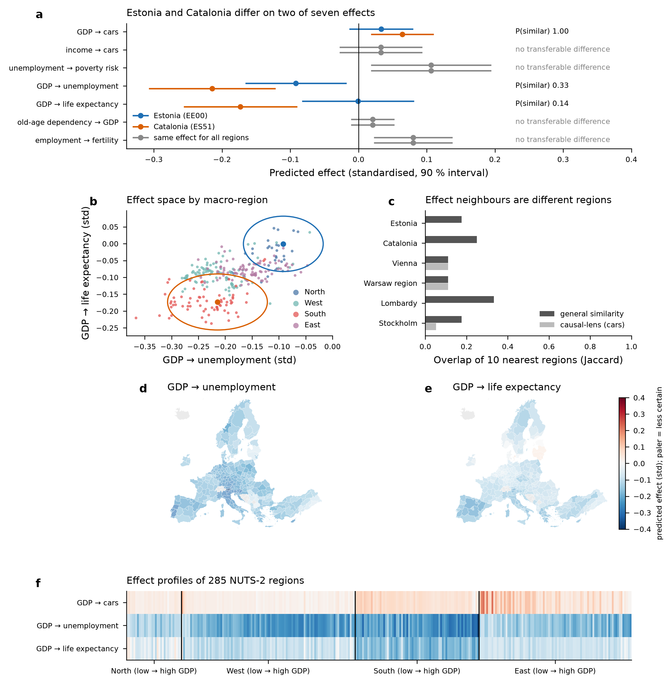
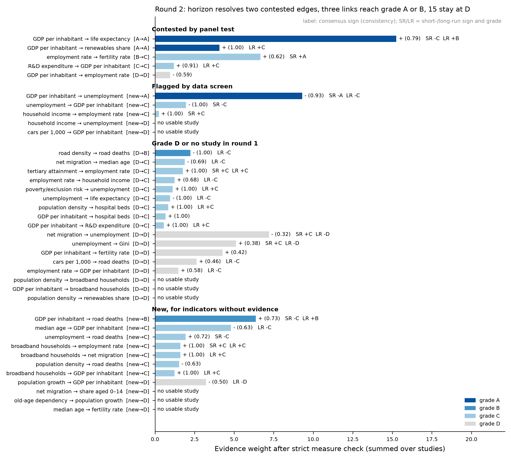
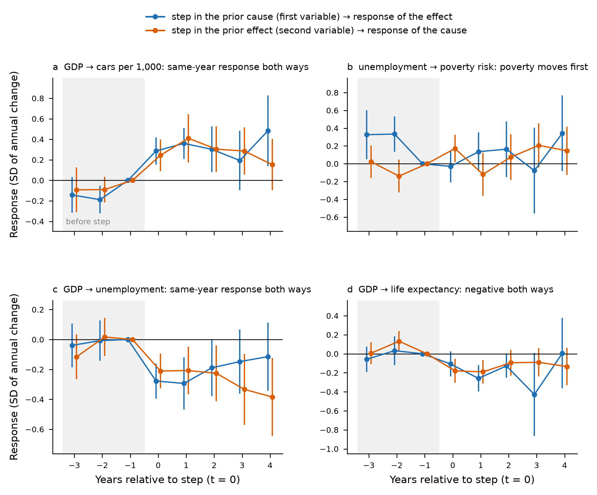

# Causal layer for regsim: addendum on effect similarity and closing knowledge gaps

## In brief

- **Effect similarity.** Region-specific effects can be used as derived indicators. regsim can then say how similar the response to a driver or measure will be in two regions, with an interval.
  - With present data this holds for three of seven tested links: GDP → life expectancy, GDP → unemployment, GDP → car ownership.
  - For the other four, one common effect predicts new countries better.
- **Targeted literature search.** The search closed part of the knowledge gap.
  - Two contradictions between literature and data disappear once short-run and long-run evidence are separated.
  - Okun's law, which the data screen had flagged, is confirmed at grade A.
  - Three indicators without any evidence (road deaths, broadband, median age) now have graded links.
  - 15 of 38 targeted links remain without usable evidence.
- **SD model review.** All three odd results in the Tallinn SD model have identified causes:
  - a calibration step that absorbs inputs that do not change over time;
  - a hard-coded value of time;
  - an inconsistent population perturbation.

  Granollers responds as expected.
- **Regional data.** Regional emission, degree-day and inequality series make four energy and inequality links testable at NUTS-2, and all four are supported. The emission series are modelled, which limits their weight as evidence.
- **Temporal precedence.** Timing adds little on annual regional data (6 of 24 prior links point the right way). It enters the registry as one weighted evidence item.

## 1 Effect similarity

Each effect is modelled as a function of regional characteristics:
- GDP level;
- current level of the outcome;
- density;
- region type.

The moderator terms are shrunk and validated by leaving one country out at a time. A link counts as heterogeneous only if the moderators reduce the hold-out error by at least 10 % against one common effect:

| Link | Hold-out error relative to common effect | Main moderator |
|---|---|---|
| GDP → life expectancy | 0.37 | negative in the South, near zero in the North |
| GDP → unemployment | 0.73 | strongest in the South, weakest in the North |
| GDP → cars per 1,000 | 0.77 | smaller where car ownership is already high |
| household income → cars, old-age dependency → GDP, unemployment → poverty, employment → fertility | 1.03 to 4.28 without shrinkage | none transferable |

Effect similarity differs from the existing similarity measures. Its distances correlate 0.41 with general similarity and 0.34 with causal-lens similarity, and the ten nearest regions overlap by at most a third. Estonia and Catalonia are practically equivalent for GDP → cars (probability 1.00) but not for GDP → unemployment (0.33) or GDP → life expectancy (0.14).

Details: effect_similarity.md, region_effects.csv.

## 2 Literature round 2

The round targeted 38 links:
- 5 contested by the panel test;
- 5 flagged by the data screen;
- 17 with grade D;
- 11 new links for indicators without evidence.

1,115 abstracts were retrieved and 158 verified claims extracted. A hand-check of 10 claims found three wrong outcomes, so a strict measure check was added as a third pass. It keeps 84 claims.

**Results after the strict check**

- **GDP → life expectancy.** Short run negative (C), long run positive (B). This matches the panel, which measures the short-run effect.
- **Employment → fertility.** Short run positive (A), matching the panel.
- **GDP → unemployment (Okun).** New, grade A, mainly regional European panels and a meta-regression.
- **Road deaths:**
  - road density → road deaths (B);
  - GDP → road deaths, long run + (B), short run − (C).
- **Broadband** → employment, net migration, GDP (C each).
- **Grades across the 38 targets:** A 3, B 2, C 18, D 15 (8 without any usable study).

Without the strict check, 14 of the 38 targets would have reached grade A or B. With it, 5 do.

Details: literature_round2.md.

## 3 SD model review

| Item | Cause | Type |
|---|---|---|
| Tallinn: cooling degree days and parking cost without effect | GC-neutral calibration at 2019 absorbs inputs that are constant over time; without it, CDD → active km −0.13 and parking → car-km −0.08 | model property |
| Tallinn: fuel cost → active km −0.34 | the calibration anchors the 2019 fuel cost, and the EV transition then makes car travel relatively cheaper; without the calibration, fuel cost → car-km −0.11 and active km +0.09 | model property |
| Tallinn: value of time without effect | constant 15 hard-coded in the Tallinn branch | implementation |
| population → emissions −0.47 | only internal population scaled, and the energy population is not linked to mobility; consistent scaling gives about 0 | perturbation set-up, model property |
| Granollers | fuel cost → car-km −0.28 (literature about −0.3 long run); CDD → active km −0.35; road pricing −0.72 and street green −0.68 on car-km | as expected |

Details: sd_model_review.md.

## 4 Regional data

Sources added:
- EDGAR NUTS-2 GHG, total and by sector, 1990–2024;
- Eurostat degree days at NUTS-2, annual and monthly;
- Eurostat S80/S20 at NUTS-2.

| Link | β std (country×year FE) | t | Note |
|---|---|---|---|
| cars per 1,000 → transport GHG per capita | 0.21 | 4.2 | modelled emissions |
| heating degree days → buildings GHG per capita | 0.44 | 10.4 | modelled emissions; check downscaling proxies |
| GDP → GHG per capita | 0.09 | 2.0 | modelled emissions |
| S80/S20 → poverty risk | 0.53 | 6.2 | same survey (EU-SILC) |

Renewables share and household electricity remain national.

Details: regional_data_gaps.md.

## 5 Temporal precedence

Over 120 pairs, lagged tests find dependencies for 12. For the 24 prior links they point the prior way 6 times, the reverse way 4 times and neither way 13 times. After step changes, both variables respond in the same year. The registry records the result per edge (`temporal_precedence`). The direction test aligns series by reference period first (EU-SILC income refers to the previous year). Timing is decisive only in event studies of dated interventions with a flat pre-trend.

## 6 Registry and hand-over

- **Registry schema 0.2: 91 edges.**
  - 49 prior, 23 hypothesis, 11 supported, 5 contested, 3 model review;
  - 5 grade A, 11 grade B, 32 grade C, 25 grade D.
- **Hand-over:**
  - adds milestone M7.6 (effect similarity), the strict measure check, `direction_test`, the revised SD perturbation protocol and the regional data sources;
  - adds three open decisions: D17 modelled emission data, D18 weight of temporal precedence, D19 equivalence threshold.

## 7 Transfer of SD calibration parameters

Calibrated SD parameters from one to three demonstrators cannot be transferred to other regions with a stated confidence:
- the calibrated cities differ widely (mode-change damping 0.04–0.84);
- Naples' calibration is close to Granollers';
- parameters are defined within a model variant;
- between-region variation cannot be estimated from three points;
- 82 % of NUTS-2 regions lie outside the demonstrators' range on at least one dimension.

**The protocol** (sd_parameter_transfer.md, configs/sd_parameter_classes.yaml) sorts parameters into classes:
- observable inputs are taken from data or regsim imputation;
- behavioural parameters are set from literature functions;
- residual calibration constants are recalibrated to target mode splits, never copied;
- structural switches stay identical between donor and target.

**Reporting rule.** Lever rankings agree between Tallinn and Granollers (road pricing > cycling attractiveness > parking), while magnitudes differ up to a factor of four. Rankings are therefore reported for all regions; absolute levels are reported only within the demonstrators' domain or after recalibration to observed data.

**Next demonstrator.** One additional western or central European regional city region would roughly double the share of regions close to a demonstrator, from 0.29 to about 0.58.
