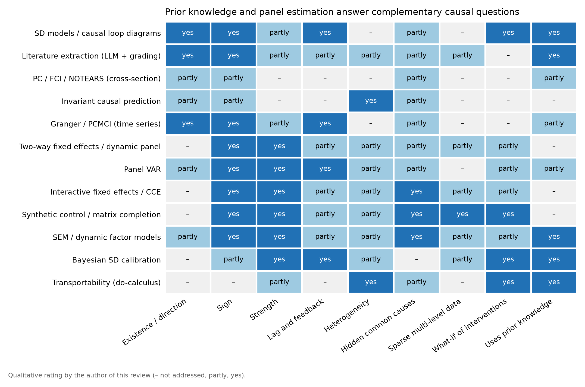
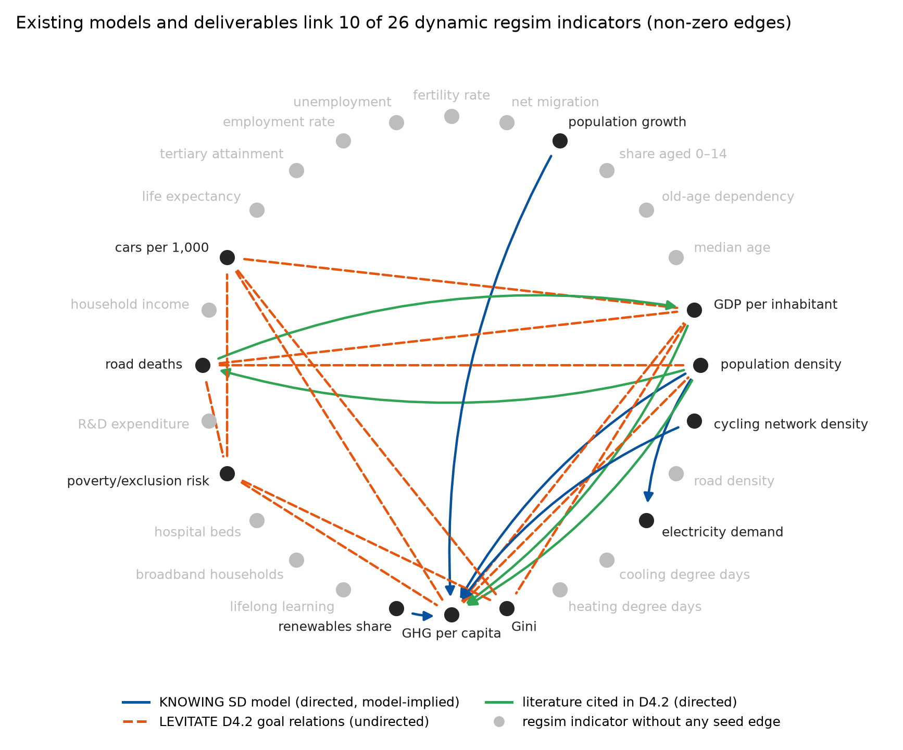
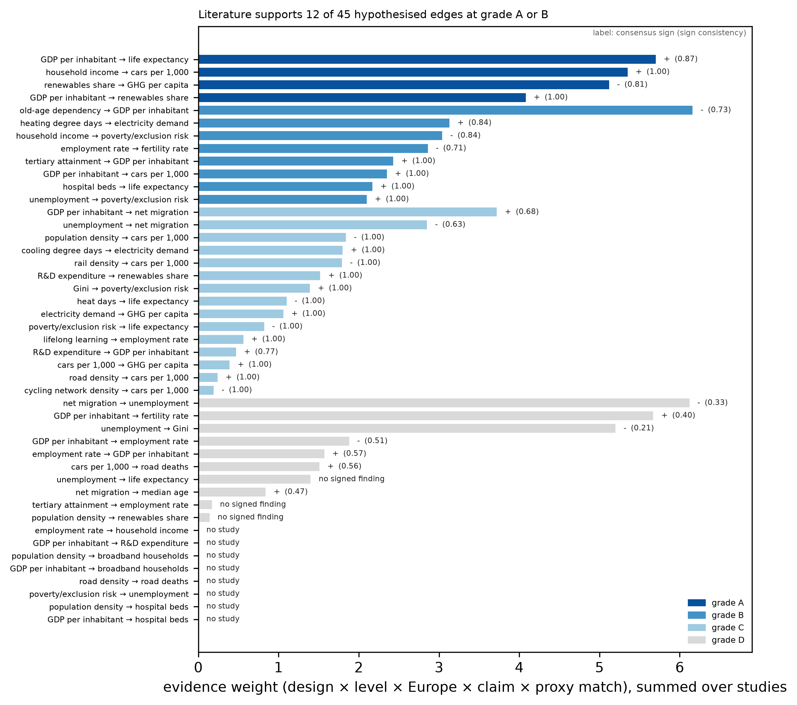
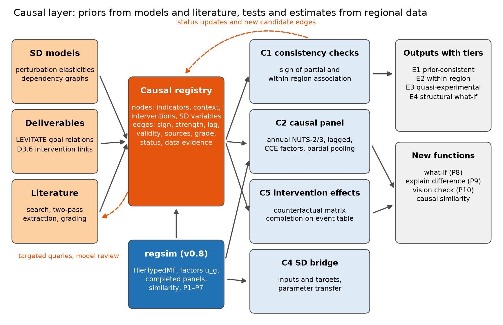
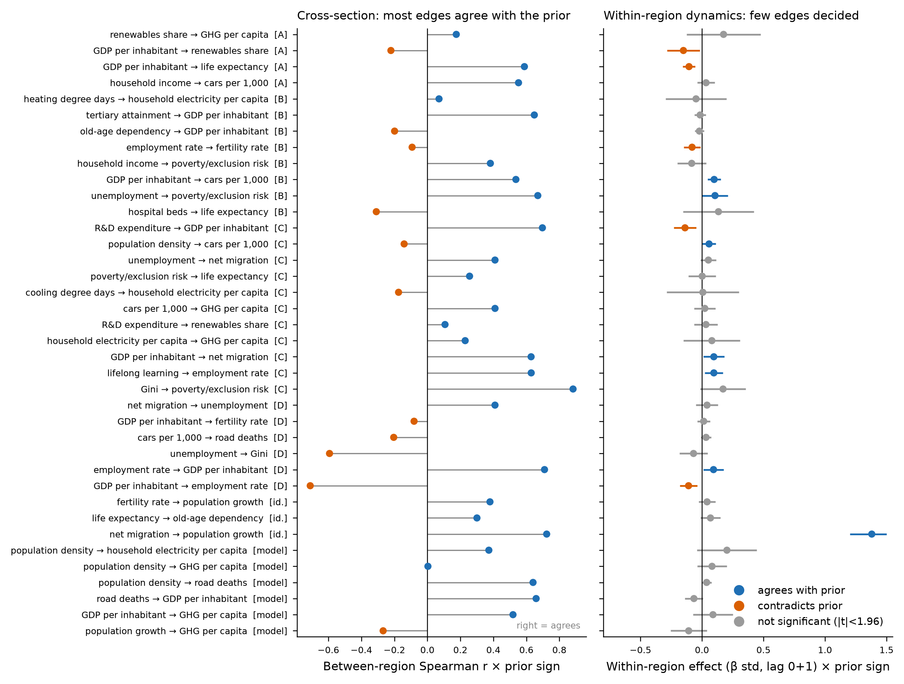
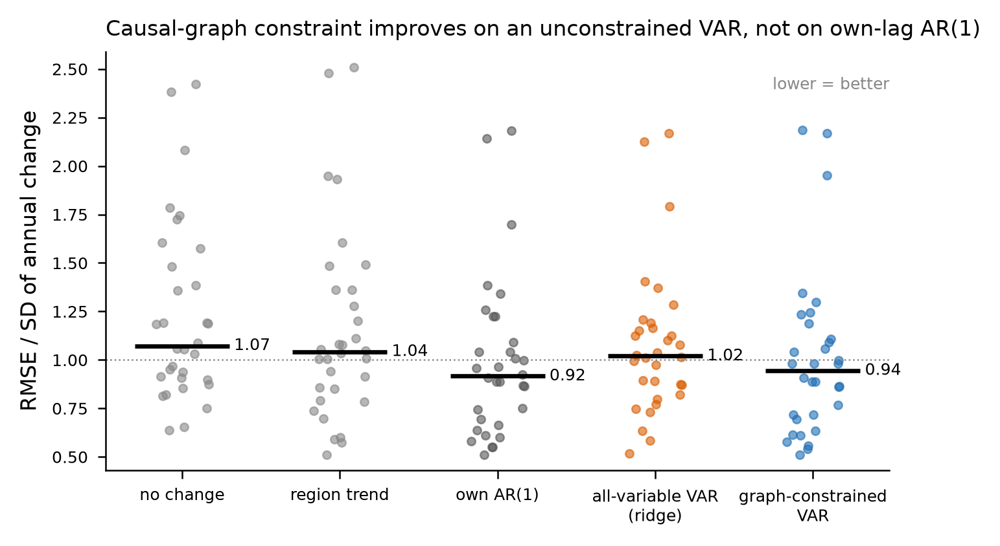
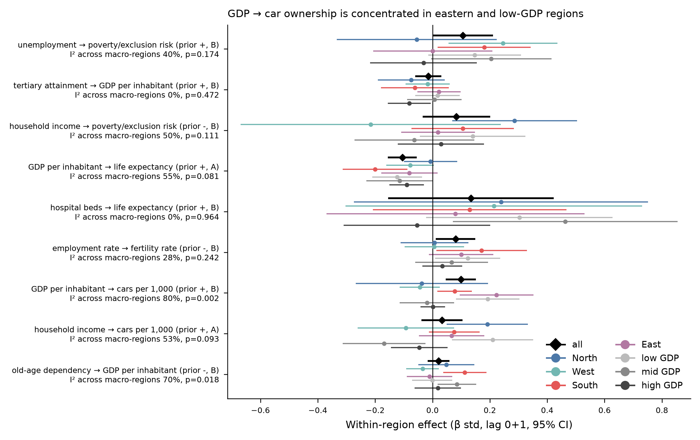
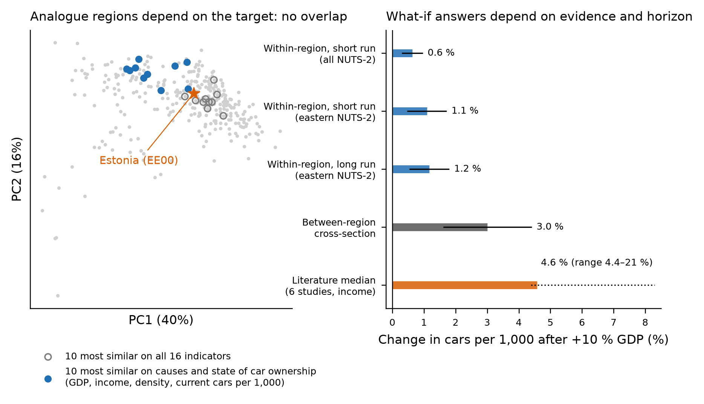

# Causal relationships in regsim: knowledge sources, empirical tests and use

## Summary

regsim measures similarity between regions and indicators and predicts missing values from associations. This report examines whether causal knowledge can be added, coming from literature and from existing qualitative and quantitative models (SD models, LEVITATE and KNOWING deliverables), and whether observed correlations and time behaviour can in turn quantify and test that knowledge.

- **Knowledge sources.** 481 seed relations were collected: 136 from the KNOWING SD models, 23 LEVITATE goal relations, 4 from LEVITATE D4.2, and 318 intervention–indicator links from KNOWING D3.6 Annex A. They cover 19 of 325 pairs among the 26 dynamic regsim indicators. Only 5 of these pairs come with a magnitude, and 15 indicators have no relation at all.
- **Literature hypotheses.** An LLM proposed 54 candidate edges for the gaps. 870 OpenAlex abstracts gave 121 relevant claims, extracted twice and verified (sign agreement between passes 83.5 %). Grading gives 4 A, 8 B, 15 C and 18 D edges plus 5 demographic identities.
- **Empirical test.** On annual NUTS-2 and national panels (2008–2024), between-region associations agree with the prior sign for 71 % of edges and within-country associations for 92 %. Within-region dynamics decide 12 of 38 signed edges: 7 supported, 5 contradicted. The contradictions come from horizon (short-run procyclical mortality against the long-run GDP → life expectancy relation), ratio denominators and population definitions, not from wrong mechanisms.
- **Use.** The causal layer answers intervention and counterfactual questions that similarity alone cannot. These are which regions are valid analogues for a given target, what follows from a change, why two regions differ, whether a vision is internally consistent, and what an intervention changed. It does little for one-year forecasts.

## 1 Methods for causal knowledge on multi-level indicator data

The review (causal_related_work.md, 57 references) groups methods into knowledge-based graphs (causal loop diagrams, text-derived causal maps, LLMs as imperfect experts, evidence grading), constraint- and score-based discovery (PC, FCI, NOTEARS, LiNGAM, invariant causal prediction), time-series methods (Granger, PCMCI, convergent cross mapping), panel econometrics (two-way fixed effects, dynamic panels, panel VAR, common correlated effects and interactive fixed effects), counterfactual estimators (synthetic control, synthetic difference-in-differences, matrix completion), latent-structure models (SEM, dynamic factor models) and SD calibration. regsim's HierTypedMF is already a matrix-completion estimator and can serve as a counterfactual model for intervention effects. Spatial confounding, ecological fallacy and the modifiable areal unit problem limit transfer across levels.

## 2 Existing causal knowledge

The SD models supply structure and, through perturbation runs, elasticities. For Tallinn in 2050, an area toll gives −0.73 and road pricing −0.42 on car-km per capita. Three responses need model review: fuel car cost → active-mode km −0.34, no effect of cooling degree days on any output, and population → total emissions −0.47. Only 12 of 136 SD edges map to regsim indicators at both ends, because SD variables are mostly city-level flows (car-km, modal shares) that are not in the regional panel. LEVITATE goal relations are undirected and enter as sign constraints in polarity space. D3.6 Annex A links interventions to indicators and effect modifiers, and is treated as an intervention map rather than an indicator graph.

## 3 Literature-based hypotheses

Literature consensus agrees with the LLM-proposed sign for 28 of 31 edges with signed evidence. LLM proposals remain hypotheses (grade D) until supported. A hand-check of six claims found one sign error in the first pass (rail → cars, corrected by verification), one misclassified design, and one study that disclaims causality. Elasticities for four edges: household income → cars 0.47, heating degree days → electricity 0.46, old-age dependency → GDP −0.55, GDP → life expectancy 0.05.

## 4 Design of the causal layer

The design (causal_layer_design.md) has a registry of edges with sign, strength, lag, horizon, validity, sources, grade, status and data evidence, and five coupling options:

- C1 consistency checks;
- C2 within-region panel estimation;
- C3 a factor-augmented structural model (deferred);
- C4 an SD bridge;
- C5 intervention effects by counterfactual matrix completion.

Every output carries an evidence tier from E0 (association) to E4 (structural counterfactual). The empirical test adds two registry fields: `horizon` (short run, long run) and `mechanism_type` (causal, accounting identity, shared denominator, shared survey base).

## 5 Empirical test

Each edge was estimated as the cumulative effect of the current and lagged change in the cause on the change in the effect, with region and country×year fixed effects (NUTS-2) or region and year effects (national), and standard errors clustered by region. Single-lag variants changed sign for the same edge (heating degree days → household electricity +0.27 at lag 0, −0.31 at lag 1), so the cumulative form is used.

Contradicted edges:

| Edge (grade) | Within-region effect | Cause of the contradiction |
|---|---|---|
| GDP → life expectancy (A) | −0.11, t −4.1 | short-run procyclical mortality (Ruhm 2000); prior is long-run |
| GDP → renewables share (A) | −0.15, t −2.2 | growth raises final energy consumption, the share's denominator |
| R&D expenditure → GDP (C) | −0.14, t −3.0 | R&D intensity is a percentage of GDP |
| employment rate → fertility (B) | +0.08, t 2.3 | prior refers to female employment across countries |
| GDP → employment rate (D) | +0.11, t 3.0 | LLM sign without literature support |

Screening all 240 ordered NUTS-2 pairs at a Bonferroni threshold flags 30 pairs. 23 of these are accounting or measurement links: shared population stock, the labour-force-survey base, per-capita denominators, employment/unemployment, and GDP/household income. Of the 7 substantive pairs, GDP ↔ unemployment (Okun's law) is missing from the candidate graph and goes back to the literature module. The screen recovers 1 of 15 graded NUTS-2 edges. At this resolution data-driven discovery flags omissions and artefacts; it does not replace the prior graph.

For hold-out forecasts of annual change (last two years per indicator), restricting cross-effects to candidate parents improves on an unconstrained ridge VAR (median relative RMSE 0.94 against 1.02). It does not improve on own-lag models (0.92).

Edge effects differ between region types. GDP → car ownership is concentrated in eastern (+0.22) and low-GDP regions (+0.19) and is near zero elsewhere (I² 80 %, p 0.002), consistent with motorisation saturation. Old-age dependency → GDP is heterogeneous as well (I² 70 %). Edge parameters should therefore be pooled partially by region type. This ties the causal layer to the dynamic typology: the similarity space that groups regions also delimits where an effect transfers.

## 6 Use

The usefulness note (causal_usefulness.md) lists ten question types. Three examples:

- **Analogues for transfer.** The ten regions most similar to Estonia on all indicators and the ten most similar on the causes and state of car ownership share no region.
- **What-if.** +10 % GDP raises car ownership in Estonia by 0.6 % to 4.6 %, depending on whether the effect is the pooled short-run, eastern short-run or long-run, cross-sectional, or literature estimate. Reporting horizon and tier with each number is therefore required.
- **Explaining a difference.** GDP, income and density leave a residual larger than the observed difference in car ownership between Estonia and Catalonia. The residual points to causes outside the graph: Estonia had no motor vehicle tax until 2025. That tax is also the first candidate for an intervention-effect estimate once 2025–2026 data are published.

## 7 Limitations

Annual changes over 17 years identify short-run effects. Long-run effects need long differences, interactive fixed effects or quasi-experiments. Country×year fixed effects remove national policy effects together with national shocks. National-only indicators (GHG, renewables, Gini, degree days, household electricity) have too little within-unit variation to decide edges, so regional series for these are the main data gap. SD edges can be tested only where regional data exist for SD variables such as car-km.

## 8 Implementation

`HANDOVER_M7_causal.md` defines milestones M7.1–M7.5 for Claude Code: registry and consistency checks; literature module; panel module with causal queries and causal-lens similarity; SD bridge; intervention effects. It also lists acceptance criteria tied to the results above and seven open decisions (D10–D16). The panel module is provided as a tested reference implementation; the remaining modules are specified as stubs.

## References

- Ball, L., Leigh, D. and Loungani, P. (2013). Okun's law: fit at fifty? NBER Working Paper 18668. doi:10.3386/w18668
- Dargay, J. and Gately, D. (1999). Income's effect on car and vehicle ownership, worldwide: 1960–2015. Transportation Research Part A 33, 101–138. doi:10.1016/S0965-8564(98)00026-3
- Ruhm, C. J. (2000). Are recessions good for your health? Quarterly Journal of Economics 115, 617–650. doi:10.1162/003355300554872
- Further references: causal_references.csv (57 entries) and causal_edges_prior.csv (DOIs per edge).
