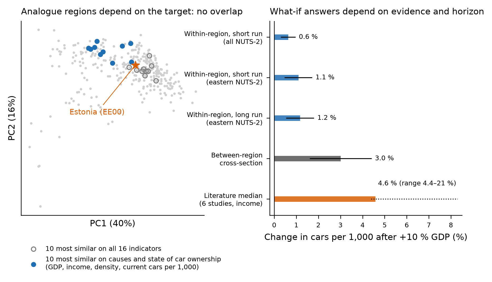

# Questions a causal layer lets regsim answer

## Scope

regsim (v0.8.0) answers association questions: which regions and indicators are similar, how typologies change, and what an unobserved value probably is. The causal layer adds questions about interventions and counterfactuals. This note lists the questions, the rung of the causal ladder (association, intervention, counterfactual) each sits on, the evidence tier reachable with present data (from the panel tests in causal_test_notes.md), and a worked example where available.

*Left: the ten regions most similar to Estonia (EE00) on all 16 NUTS-2 indicators and on the causes and state of car ownership share no region. Right: the response of car ownership in Estonia to +10 % GDP under five evidence sources; bars are point estimates, solid lines 95 % intervals, dotted line the literature range.*

## Question catalogue

| # | Question | Typical user | Rung | regsim today | With causal layer | Tier now |
|---|---|---|---|---|---|---|
| Q1 | Which regions are suitable analogues for transferring an intervention, an elasticity or an SD parameter set? | KNOWING demonstrators, D3.6 transferability | intervention (transport) | similarity on all indicators or a user lens | `s_causal`: similarity on the parents and effect modifiers of the target | E1–E2 |
| Q2 | If X changes by Δ in region g, what follows for Y and its descendants? | policy makers, scenario design | intervention | none (imputation only) | `what_if` (P8) along the graph, with horizon-specific effects and intervals | E2 short run; long run E1 / literature |
| Q3 | Why does Y differ between regions g and h? | regional analysts | association → counterfactual | similarity decomposition by indicator | `explain_difference` (P9): path contributions of parents plus an unexplained residual | E0–E2 |
| Q4 | Are the targets of a vision jointly consistent, given causal relations and lags? | backcasting (KNOWING D2.x) | counterfactual | none | `vision_check` (P10): required lever change per target, conflicts flagged | E2–E4 |
| Q5 | Which co-benefits and trade-offs does an intervention bring across goals? | LEVITATE-type impact assessment | intervention | goal relations as undirected polarity | effects propagated from D3.6 intervention links through the indicator graph to several goals | E1–E3 |
| Q6 | Did intervention I change Y where it was implemented? | evaluators | counterfactual | HierTypedMF can impute an untreated path | `events.effect` (C5): counterfactual matrix completion on lens analogues | E3 |
| Q7 | Do the elasticities of an SD model agree with observed regional behaviour, and which parameters transfer? | KNOWING modellers | intervention | none | `sd_bridge` (C4): edge import, comparison with panel and literature, flags | E2–E4 |
| Q8 | Which relationships are undecided, and which observation would decide them? | data and monitoring | — | indicator coverage only | evidence tiers per edge; required resolution and series length | — |
| Q9 | Where does the evidence base have gaps? | researchers, literature loop | — | none | data-flagged dependencies without prior go to the literature module; contested edges listed | — |
| Q10 | Is an imputed or forecast value consistent with known relations? | all regsim users | association | uncertainty bands only | sign and magnitude checks (C1) on predictions | E1 |

## Worked examples

### Q1 Analogues for Tallinn

General similarity on 16 indicators places Estonia next to Slovenian, Danish, Finnish and northern British regions. On the causes and state of car ownership (GDP, household income, density, current motorisation) the nearest regions are in northern Spain, Lithuania, southern Italy, Czechia, Portugal, Croatia and Poland. The two sets do not overlap (Jaccard 0.00); for Catalonia (ES51) the overlap is also 0.00, for Vienna (AT13) 0.33. A transfer of the Tallinn road-pricing response should therefore be checked against regions from the second set. The heterogeneity test supports this choice of lens: the GDP → car ownership effect is concentrated in eastern and low-GDP regions (I² 80 %).

### Q2 What-if for GDP and car ownership

+10 % GDP in Estonia raises cars per 1,000 by 0.6 % (within-region, short run, all NUTS-2), 1.1 % (eastern regions, short run), 1.2 % (eastern regions, long run from the autoregressive term), 3.0 % (between-region cross-section) or 4.6 % (literature median, income elasticity 0.47, range 4.4–21 %). The spread is the answer's main content: the within-region estimates describe a year-to-year response with country×year shocks removed; the cross-section and literature describe long-run differences that include infrastructure and settlement structure. `what_if` must report the horizon and evidence tier with every number.

### Q3 Car ownership in Estonia and Catalonia

Estonia has 21 % (log points) more cars per 1,000 than Catalonia (2015–2024 means). A between-region regression on GDP, household income and density attributes −0.31 to lower income, +0.04 to GDP and +0.07 to density; the residual of +0.40 exceeds the observed difference. The causal graph lacks the relevant nodes: until 2025 Estonia was one of the few European countries without motor vehicle taxes (OECD ECOSCOPE 2025), and rail and urban transit supply differ. An explanation with a large residual is informative: it names the missing causes and sends them to the literature and indicator lists.

### Q4 A vision for an eastern region

A vision combining GDP growth of 2 % a year over ten years with a 10 % reduction in car ownership: the eastern long-run elasticity implies +2.4 % cars from growth alone, the literature elasticity +9.8 %. The required lever effect is therefore −12 % to −20 %. The Tallinn SD model gives elasticities for area toll (−0.73) and road pricing (−0.42) on car-km per capita, not on ownership; `vision_check` must flag the mismatch of target variable before combining them.

### Q6 Estonian motor vehicle tax

Estonia introduced an annual motor vehicle tax and a registration fee on 1 January 2025. With 2025–2026 Eurostat data, C5 can estimate the effect on cars per 1,000 against a counterfactual from the Q1 analogue set. Registrations fell in 2025 partly because purchases were brought forward into 2024 in anticipation (OECD ECOSCOPE 2025); the pre-treatment window must end before the announcement, otherwise the no-anticipation assumption fails and the effect is overstated.

### Q7 Tallinn SD elasticities

The SD perturbation runs (2050) give three responses for modellers to review: fuel car cost → active-mode km −0.34 (a rise in car cost reduces walking and cycling), cooling degree days with no effect on any output, and population → total emissions −0.47 (probably per-capita normalisation). The panel test cannot check these edges directly because car-km and active-mode km are not in the NUTS-2 panel; they are recorded as `status: model_review`.

## Evidence achievable with present data

- Between-region associations agree with prior signs for 71 % of edges and within-country associations for 92 %; these support E1 statements.
- Within-region dynamics decide 12 of 38 signed edges (7 supported, 5 contradicted). The contradictions concern horizon (GDP → life expectancy), ratio denominators (GDP → renewables share, R&D intensity) and population definitions (employment → fertility). E2 statements are possible for short-run effects only.
- The graph constraint improves forecasts against an unconstrained VAR (median relative RMSE 0.94 vs 1.02) but not against own-lag models (0.92). Forecasting is not a reason for the extension.
- National-only indicators (GHG, renewables, Gini, degree days, household electricity) have too little within-unit variation over 2008–2024 to decide edges; regional series (e.g. EDGAR or JRC regional emissions, regional energy balances) are the main data gap.

## Questions outside the reach of the extension

- Long-run causal effects from annual co-movement alone; these need long differences, interactive fixed effects or quasi-experiments.
- Effects of national policies when country×year fixed effects are used; national policy evaluation needs the national panel or C5 with country units.
- Transfer of relations across levels (NUTS-2 to LAU) without data at the target level.
- Claims about edges proposed only by the LLM step (grade D) beyond "hypothesis".

## Priority for implementation

| Function | Value for KNOWING / LEVITATE use | Data readiness | Priority |
|---|---|---|---|
| `s_causal` (Q1) | high: core of transferability | ready | 1 |
| registry + C1 checks (Q8–Q10) | high: basis for all others | ready | 1 |
| `what_if` with horizon and tier (Q2) | high | short run ready; long run from literature | 2 |
| `sd_bridge` (Q7) | high for WP2 | structural edges extracted from the Vensim models; perturbation elasticities for Tallinn | 2 |
| `explain_difference` (Q3) | medium | ready | 3 |
| `events.effect` (Q6) | medium–high | needs event list and post-treatment years | 3 |
| `vision_check` (Q4) | high for backcasting | depends on Q2 and Q7 | 4 |

## References

- Dargay, J. and Gately, D. (1999). Income's effect on car and vehicle ownership, worldwide: 1960–2015. Transportation Research Part A 33, 101–138. doi:10.1016/S0965-8564(98)00026-3
- Ruhm, C. J. (2000). Are recessions good for your health? Quarterly Journal of Economics 115, 617–650. doi:10.1162/003355300554872
- Ball, L., Leigh, D. and Loungani, P. (2013). Okun's law: fit at fifty? NBER Working Paper 18668. doi:10.3386/w18668
- OECD ECOSCOPE (2025). Estonia's new car tax and registration fee: are they changing consumer demand? 16 September 2025.
