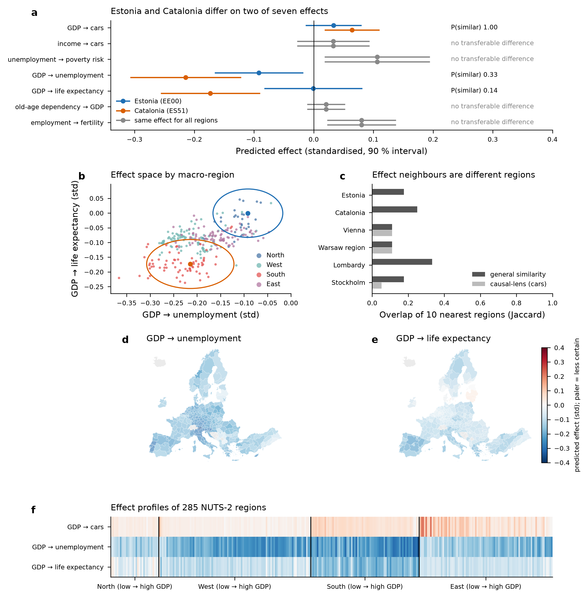

# Effect similarity: region-specific causal effects as derived indicators

## Question

Can the parameters that describe how causal effects differ between region types be treated as derived indicators, so that regsim can say how similar the effect of a driver or measure will be in region A and region B?

## Method

One effect per region estimated from its own 15 annual values is too noisy. Each effect is instead modelled as a function of regional characteristics (moderators), estimated on all regions together:

- Annual change of the effect indicator on current and lagged change of the cause, with region and country×year fixed effects and the lagged change of the effect. This is the same specification as the M7 panel module.
- The cumulative effect varies linearly with standardised moderators: mean log GDP per inhabitant, mean level of the effect indicator (saturation), mean log density, and macro-region (North, South, East against West).
- Moderator terms are shrunk with a ridge penalty. The penalty for each link is chosen by leave-one-country-out validation: the model is fitted without one country, the country's own effect is predicted, and the prediction is compared with an estimate from that country's data alone. Prediction errors are precision-weighted.
- A link is treated as heterogeneous only if moderators reduce the hold-out error by at least 10 % against one pooled effect. Otherwise all regions get the pooled effect.

Outputs per region and link: predicted effect (standardised by the within-region standard deviations of the changes), 90 % interval, and flag `heterogeneous` (region_effects.csv, 285 NUTS-2 regions × 7 links).

## Validation

| Link | Countries held out | Hold-out error relative to pooled effect | Used as heterogeneous |
|---|---|---|---|
| GDP → life expectancy | 21 | 0.37 | yes |
| GDP → unemployment | 21 | 0.73 | yes |
| GDP → cars per 1,000 | 19 | 0.77 (strong shrinkage) | yes |
| household income → cars per 1,000 | 17 | 4.28 without shrinkage | no |
| old-age dependency → GDP | 20 | 1.41 without shrinkage | no |
| unemployment → poverty risk | 14 | 1.11 without shrinkage | no |
| employment rate → fertility | 23 | 1.03 without shrinkage | no |

Moderators were jointly significant in-sample for all seven links (p ≤ 0.045). Only three transfer to countries outside the estimation sample. The other four fit noise and give worse predictions than one common effect.

What drives the three heterogeneous effects (change in standardised effect per standard deviation of the moderator, or for the region-type dummies):

- **GDP → cars:** smaller where car ownership is already high (−0.03 per SD), consistent with saturation; slightly larger in the South.
- **GDP → unemployment:** most negative (strongest Okun relation) in the South (−0.09); weakest in the North (+0.10) and in regions with high unemployment levels.
- **GDP → life expectancy:** most negative in the South (−0.07), close to zero in the North (+0.10), less negative in dense regions.

## Effect similarity

For regions A and B and a heterogeneous link, the difference of predicted effects has a known standard error, because both predictions come from the same model. Two measures:

- **Probability of practical equivalence**, P(|β_A − β_B| < 0.1 SD). Example Estonia vs Catalonia: GDP → cars 1.00, GDP → unemployment 0.33, GDP → life expectancy 0.14.
- **Effect distance**, the root mean square of the effect differences over the heterogeneous links. It defines nearest neighbours in effect space.

Links without transferable heterogeneity are reported as "no transferable difference". This means the data do not support a difference, not that equality is proven.

Effect similarity carries different information from the existing similarity measures:

- **Distance matrices.** Rank correlation with general similarity on 16 indicators is 0.41, with causal-lens similarity for car ownership 0.34.
- **Nearest neighbours.** The 10 nearest regions overlap with the general-similarity neighbours by Jaccard 0.11–0.33 and with the lens neighbours by 0–0.11 (Estonia, Catalonia, Vienna, Warsaw region, Lombardy, Stockholm). Warsaw's effect neighbours are western German regions; Estonia's are Nordic capital regions.

In regsim terms, effect similarity is a learned lens: the moderators are weighted by how much they change the effect, so only characteristics relevant for the effect count.

## Visualisation catalogue

| View | Question | Panel |
|---|---|---|
| Pairwise effect comparison | Will a driver or measure act alike in A and B? | a: each link's effect with interval for both regions, probability of practical equivalence, pooled links greyed |
| Effect space | Which regions respond alike on two links, and how certain is the position? | b: scatter of predicted effects with 90 % ellipses, coloured by region type |
| Neighbour comparison | Are effect neighbours the same as general or lens neighbours? | c: Jaccard overlap of 10 nearest regions |
| Effect maps | Where is an effect strong or weak? | d, e: diverging colours centred at zero, paler where the interval is wide (value-suppressing palette) |
| Effect profile strip | How do effect profiles vary within and between region types? | f: regions × links, ordered by macro-region and GDP |

Further views for the app:
- a transfer matrix (pioneer × follower regions, cells = probability of practical equivalence on the links relevant to a measure);
- effect-space PCA when more than three links are heterogeneous;
- a typology of effect profiles, where clustering in effect space gives "response types" next to the existing structural types.

## Integration in regsim

- **Derived indicators.** Store region effects in the observation store as derived indicators of type `effect` (id `effect:<cause>→<effect>`, value, interval, model version, horizon short run). They are not used as model inputs for HierTypedMF, to avoid circularity.
- **Lens option.** `similarity.s_effect(geo, links)` computes the effect distance and equivalence probabilities; `predict.analogues(..., lens="effect:<link>")` uses it.
- **Validation as a gate.** Region effects are published only for links that pass the leave-one-country-out gate; the others are exposed as one pooled effect.
- **Visual encoding.** Every effect view shows uncertainty: intervals, ellipses, or a value-suppressing palette.

## Limits

Effects are short-run, within-region effects from annual data. Only three of seven tested links have transferable heterogeneity with the present moderators. More links need longer series, more moderators (e.g. transport supply, sector structure) or literature estimates by region type.
