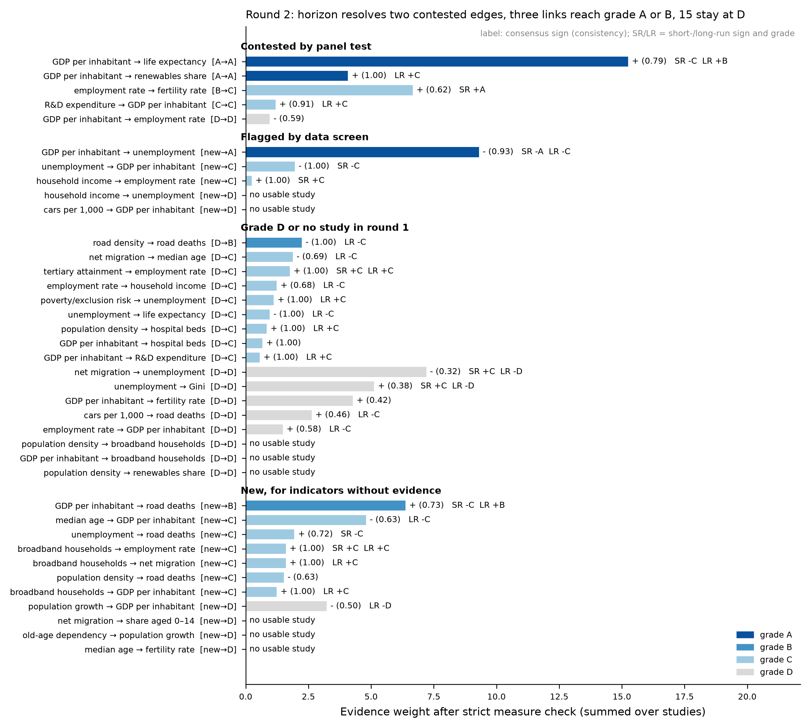

# Targeted literature round on remaining causal knowledge gaps

## Targets

38 edges in four groups:

| Group | Edges | Source |
|---|---|---|
| Contested by the panel test | 5 | GDP → life expectancy, GDP → renewables share, R&D → GDP, employment → fertility, GDP → employment |
| Flagged by the data screen, not in the graph | 5 | GDP ↔ unemployment (Okun), household income → unemployment and → employment, cars → GDP |
| Grade D or no study in round 1 | 17 | all remaining D edges |
| New edges for indicators without evidence | 11 | proposed by the reasoning model for median age, share aged 0–14, population growth, road deaths, broadband (definitional relations excluded) |

## Procedure

1. Three targeted queries per edge (114 queries), generated by the reasoning model. For contested edges, one query targets the short-run effect and one the long-run effect.
2. OpenAlex retrieval: 10 articles with abstracts per query, from 1995 → 1,115 abstracts.
3. First extraction pass (utility model) with the new fields horizon and measure note → 267 relevant.
4. Verification pass (reasoning model): direction, sign translated to the stated cause and effect, horizon, design, claim strength, quantity match. 204 claims state a direction from cause to effect (or both directions); 158 of these have a usable sign. Sign agreement between passes is 61 % (round 1: 83.5 %). The first pass often reported the sign of a proxy, such as mortality instead of life expectancy.
5. Hand-check of 10 verified claims (literature_r2_handcheck.csv):
   - 5 correct;
   - 2 close proxies;
   - 3 wrong or distant outcomes: all-cause mortality used for road deaths, disability insurance used for life expectancy, and an individual re-training programme used for tertiary attainment.
6. Added a strict measure check (reasoning model): does the study measure the cause and the effect themselves or their standard proxy, on a population representative of regions? It keeps 84 of 158 claims. All three wrong cases from the hand-check are removed.
7. Grading with the round-1 weights and rules, on round-2 claims that pass the strict check plus the round-1 claims for the same edges. Grades are reported overall and separately for short-run and long-run findings.

## Results

**Contested edges**
- **GDP → life expectancy (A).** The horizon split matches the panel result. Short-run evidence is negative (procyclical mortality, grade C); long-run evidence is positive (grade B). The registry gets two edges with opposite signs and different horizons.
- **Employment → fertility.** Short-run evidence is positive (grade A): fertility moves with the business cycle, as in the panel test. The negative long-run sign of round 1 refers to female employment across countries and no longer passes the strict check.
- **GDP → renewables share (A, long run).** No short-run study passes the strict check. The negative within-region panel effect remains a ratio artefact: growth raises total energy use, which is the denominator of the share.
- **R&D → GDP (C, long run).** No change. The panel contradiction is the R&D/GDP ratio definition.
- **GDP → employment.** The LLM sign (−) in round 1 was wrong. The Okun literature implies +, but its studies measure unemployment rather than the employment rate and are removed by the strict check. The edge is therefore merged with GDP → unemployment.

**Data-flagged edges**
- **GDP → unemployment (new, A; short run A).** Okun's law at regional level, including Spanish and European regional panels and a meta-regression. The data screen found an omission that the literature confirms.
- **Unemployment → GDP (C)** and **household income → employment (C)** are supported weakly. Household income → unemployment and cars → GDP have no usable study; the latter is treated as a data artefact.

**Former grade D**
- One edge reaches B: road density → road deaths, negative, long run.
- Eight reach C: net migration → median age (−), tertiary attainment → employment (+), employment → household income (+), poverty → unemployment (+), unemployment → life expectancy (−), density → hospital beds (+), GDP → hospital beds (+), GDP → R&D intensity (+).
- Six have conflicting evidence: net migration → unemployment, unemployment → Gini, GDP → fertility, cars → road deaths, employment → GDP, and population growth → GDP. In several cases short-run and long-run studies point in opposite directions.

**Indicators without evidence**
- **Road deaths** now has graded causes:
  - GDP: long run + (B), short run − (C);
  - unemployment: short run − (C);
  - road density: − (B);
  - population density: − (C).
- **Broadband households** affects employment (C), net migration (C) and GDP (C). No usable study covers its own drivers.
- **Median age** has one cause and one effect at grade C: net migration → median age and median age → GDP.
- Share aged 0–14 and population growth remain without evidence beyond demographic identities.

**Overall, among the 38 targets:**
- grade A: 3 (including the new Okun edge);
- grade B: 2;
- grade C: 18;
- grade D: 15 (8 without any usable study).

Seven contested or data-flagged edges now have a horizon-specific sign.

## Consequences for the registry and the literature module

- Store sign and grade per horizon (short run, long run) and keep both when they differ.
- Make the strict measure check a mandatory third pass. Without it, grades are inflated by proxies: 14 of the 38 targets would reach grade A or B, but only 5 do after the strict check.
- The data screen is a productive source of literature targets. Okun's law went from "not in the graph" to grade A in one round.
- The remaining D edges need expert or modeller input, or a different evidence base such as grey literature or national statistics reports. Further abstract searching is unlikely to help.

## Files

- causal_edges_literature_r2.csv: grades per target (round-1 grade, lenient and strict grades, short- and long-run consensus)
- lit_r2_claims_graded.csv: all verified claims with measure check
- lit_r2_targets.csv, lit_r2_queries.csv, lit_r2_hits.csv: targets, queries, retrieved records
- literature_r2_handcheck.csv: hand-check of 10 claims
