# Worked example: Vienna and Estonia

This walkthrough runs regsim end to end on the two stores of the repository. Part 1 uses the cross-sectional
store (`configs/example.yaml`, NUTS-0/2/3, period 2018/2022) for similarity, gap filling, typology and visions,
with Vienna (AT130) as the reference region. Part 2 uses the annual panel store (`configs/causal.yaml`,
NUTS-0/2, 2008–2024) for the causal layer, with Estonia (EE00) as the reference region.

All figures and numbers below come from one script:

```bash
regsim build configs/example.yaml
regsim build configs/causal.yaml
regsim causal fit --config configs/causal.yaml
regsim causal effects --config configs/causal.yaml
REGSIM_SD_MODEL=<checkout of KNOWING-integrated-SD-model> python examples/walkthrough.py
```

The script writes the figures to `docs/examples/figures/` and the key numbers to
`docs/examples/walkthrough_results.json` (about 20 s once the fits are cached). Without `REGSIM_SD_MODEL`
step 12 is skipped.

## Part 1: similarity, prediction and typology (Vienna)

### 1 Data coverage

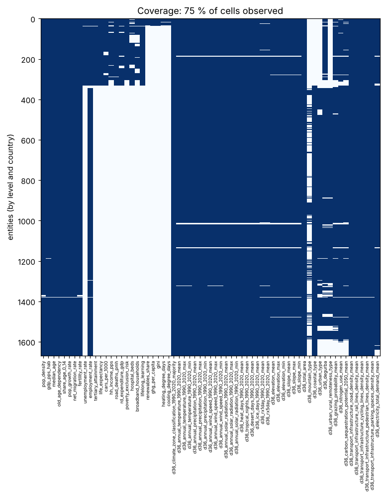

The model works on 1,669 regions × 65 indicators, of which 75 % of the cells are observed. Gaps are not
imputed in advance: the matrix factorisation (HierTypedMF) learns from the observed cells only, and every
prediction carries a conformal interval.

```python
from regsim.api.runtime import fit
f = fit(RunConfig.from_yaml("configs/example.yaml"))   # cached by config hash
V.coverage_matrix(f.data)
```

### 2 Nearest regions to Vienna

```python
nb = nearest(s_profile(model, data, Lens(levels=(3,))), wien, k=10)
```

| rank | region | score | differs most in |
|---|---|---|---|
| 1 | Berlin (DE300) | 91.6 | broadband households, rail density, lifelong learning |
| 2 | Miasto Wrocław (PL514) | 90.7 | road deaths, rail density, cars per 1,000 |
| 3 | Ludwigshafen am Rhein (DEB34) | 90.6 | lifelong learning, road deaths, unemployment |
| 4 | Nürnberg (DE254) | 90.1 | lifelong learning, road deaths, unemployment |
| 5 | Leipzig (DED51) | 89.6 | rail density, road deaths, lifelong learning |

The score (0–100) is a similarity of the completed profiles in the model's latent space, restricted to
NUTS-3 regions. `top_contributors` names the indicators that separate the pair most.

### 3 Difference profile Vienna – Berlin

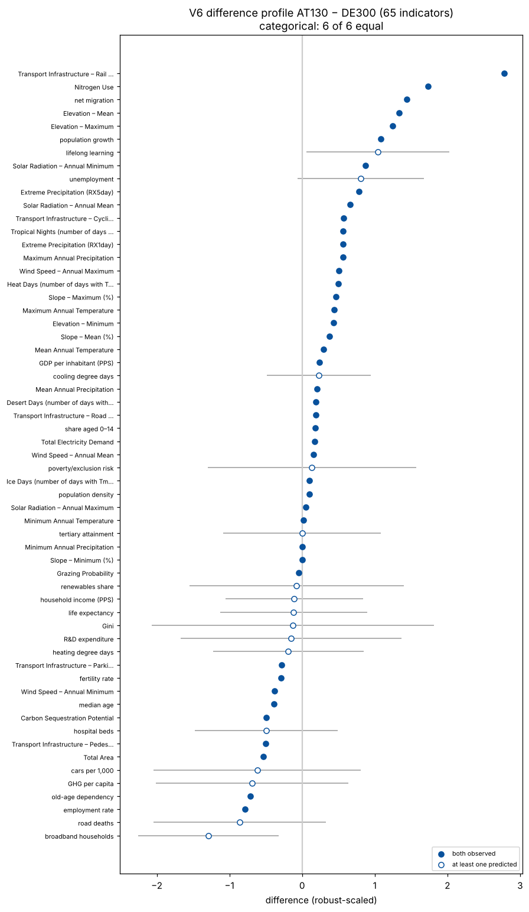

```python
V.difference_profile(model, data, wien, berlin, labels=indicator_labels)
```

Each dot is the difference Vienna − Berlin on the robust-scaled model scale. Filled dots compare two
observed values; open dots involve at least one predicted value and carry a 90 % interval. Vienna has a
much denser rail network, more net migration and higher elevation; Berlin has more broadband coverage and
a higher employment rate. The wide intervals on road deaths, cars and GHG per capita show where at least one
of the two values is predicted.

### 4 Gap filling

`fill_gaps(model, wien)` returns all 65 indicators for Vienna, 42 of them observed. Examples of predicted
values: broadband households 91.4 % (86.5–96.3), cars per 1,000 350 (206–495), cooling degree days 45
(20–103). The width of the interval is the model's own statement of how well the indicator can be inferred
from the rest of the profile.

### 5 Typology of NUTS-2 regions

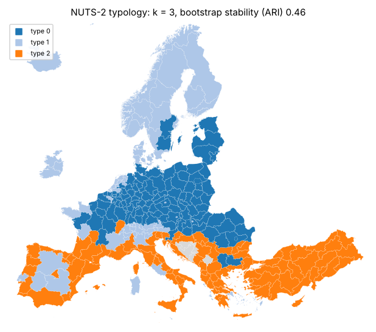

```python
ty = run_typology(f.base, data, TypologyRun(lens=Lens(levels=(2,)), n_boot=10, seed=0))
```

The typology selects k = 3 types with an overall bootstrap stability (adjusted Rand index) of 0.46:

| type | size | profile (strongest deviations) | stability |
|---|---|---|---|
| 0 | 114 | many hospital beds, low unemployment, flat terrain | 0.78 |
| 1 | 84 | few road deaths, much lifelong learning, high tertiary attainment | 0.53 |
| 2 | 97 | high unemployment, high solar radiation | 0.79 |

Vienna (AT13) belongs to type 1, together with most Nordic regions, central Spain and the western Alps. Types 0 and 2 are stable; type 1 is the least stable and acts partly as a remainder class.

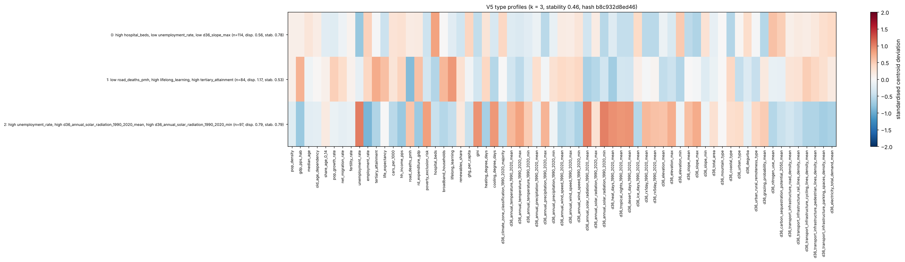

### 6 Biplot

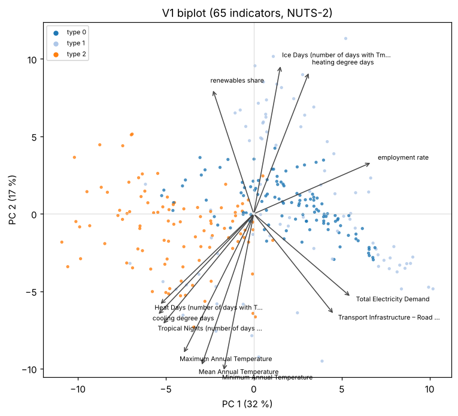

The biplot projects the NUTS-2 regions onto the first two principal components of the completed profiles
(49 % of the variance). The first axis separates warm southern regions (left) from regions with high
employment and dense road networks (right); the second axis is climate and energy (heating degree days and
renewables up, heat days down). Type 1 spreads along the upper right, which is consistent with its lower
stability.

### 7 Vision: Vienna with 60 % tertiary attainment

```python
vision = vision_entity(model, wien, {"tertiary_attainment": 60.0})
analogues(model, dict(zip(vision.indicator, vision.vision)), k=6, level=3)
```

A vision fixes one or more indicators and lets the model complete the rest of the profile consistently
with the data. Raising tertiary attainment from 44.6 % to 60 % moves Vienna's profile most strongly in:

| indicator | present | vision | 90 % interval |
|---|---|---|---|
| cars per 1,000 | 350 | 531 | 347–715 |
| GDP per inhabitant (PPS) | 46,560 | 66,492 | 44,554–99,233 |
| GHG per capita | 10.6 | 8.2 | 5.8–11.6 |
| ice days | 19.3 | 8.3 | 2.9–21.2 |
| road deaths per million | 7.6 | 10.4 | 6.1–17.3 |

The vision is a statement about co-occurrence, not about consequences: regions with 60 % tertiary attainment
are, on average, richer, have more cars and a milder climate. Ice days cannot follow from education; they
change because the regions that match the vision lie elsewhere. The analogues of the vision (existing
regions closest to it) are Ludwigshafen, Wrocław, Karlsruhe, Val-de-Marne and Nürnberg. The causal
question "what happens if…" is answered in part 2.

## Part 2: causal layer (Estonia)

### 8 Consistency of the edge registry with the data

`run_check(cfg)` compares the sign of every edge in `configs/causal_edges.yaml` with the panel data. Between
countries 40 of 53 testable edges agree in sign; within countries over time 39 of 44 agree. Disagreeing
edges are not removed automatically; they are reported for review.

### 9 What if GDP per inhabitant in Estonia rises by 10 %?

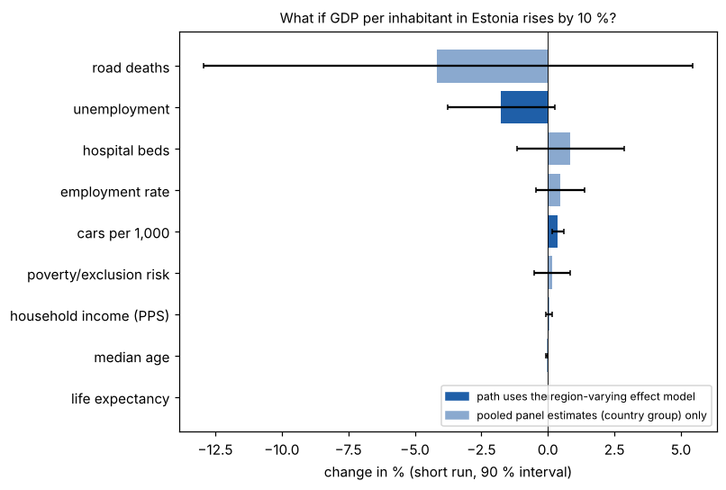

```python
run_what_if(cfg, "EE00", {"gdp_pps_hab": 0.10})
```

The shock is propagated along the registry edges with estimated short-run effects. Dark bars use the
region-varying effect model for at least one link of the path (decision D12a); light bars rest on pooled
panel estimates for the country group only.

- Cars per 1,000: +0.38 % (0.15 to 0.61), the only clearly non-zero effect.
- Unemployment: −1.8 %, interval crosses zero.
- Road deaths: −4.2 % with a very wide interval (−13 % to +5 %); road deaths are small counts per million.
- Net migration rises by 3.6 per 1,000 inhabitants (reported as an absolute change because the rate is
  close to zero).
- Life expectancy, median age and household income hardly move in the short run.

The contrast with step 7 is the point of the causal layer: the vision suggests that a richer, better
educated Vienna has 50 % more cars, while the estimated short-run effect of 10 % more GDP on car ownership in
Estonia is below half a percent.

### 10 Effect similarity: Estonia and Catalonia

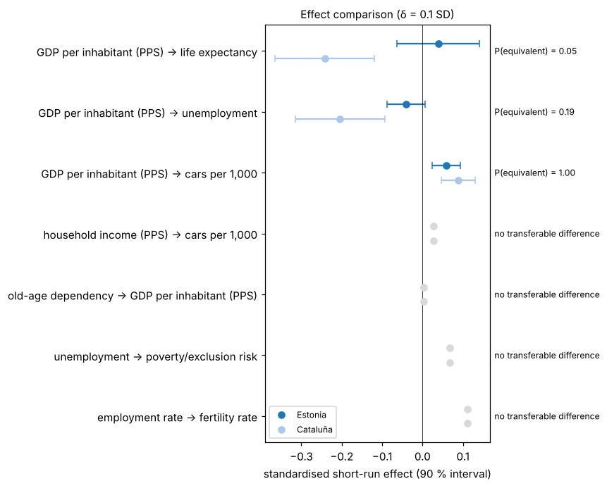

```python
s_effect(fits, "NUTS2024:EE00", "NUTS2024:ES51", delta=0.1)
```

Two regions are effect-similar on a link when their region-specific effects differ by less than δ = 0.1
standard deviations (decision D19). Only links that pass the leave-one-country-out gate are heterogeneous
across Europe; for all others regsim reports "no transferable difference" (grey).

- GDP → cars per 1,000: equivalent (P = 1.00). A measure that works through income on car ownership in
  Catalonia is a reasonable reference for Estonia.
- GDP → life expectancy: P = 0.05, the effects differ (about zero in Estonia, negative in Catalonia).
- GDP → unemployment: P = 0.19, undecided.

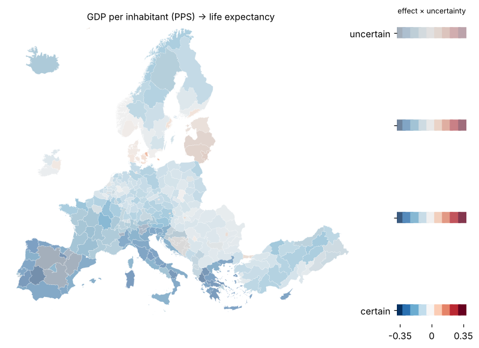

The effect map shows the region-specific effect of GDP on life expectancy; the value-suppressing palette
fades the colour where the interval is wide, so pale regions carry little information.

### 11 Intervention: the Estonian motor vehicle tax

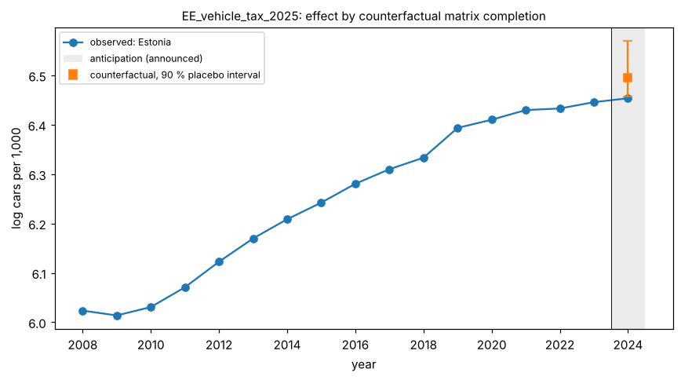

```python
effect(None, load_events("configs/events.yaml"), "cars_per_1000", analogues=20, placebo=200, seed=0, panel=p)
```

The motor vehicle tax was announced in 2024 and came into force in 2025. Matrix completion (two-way fixed
effects followed by soft-impute over 20 analogue regions) predicts the 2024 car stock without the
announcement. The observed value lies 4.2 % below the counterfactual (90 % placebo interval −11.6 % to
−0.4 %, placebo p = 0.08). This is an anticipation effect over one year: purchases were brought forward or
postponed around the announcement. The effect after entry into force needs the 2025 data.

### 12 SD model: levers and transferability

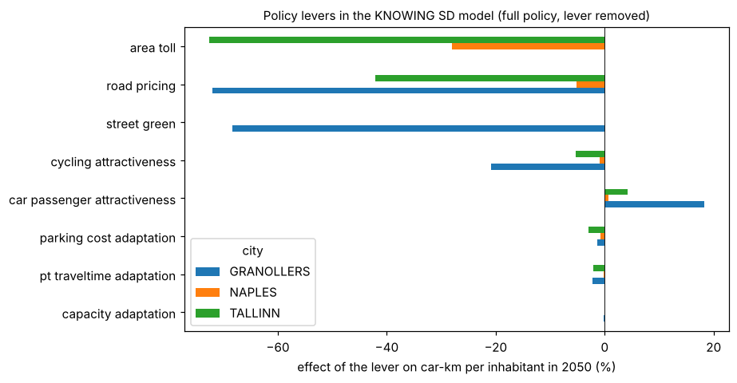

The KNOWING system-dynamics model is run for the full policy package and with one lever removed at a time;
the bar is the change in car-km per inhabitant in 2050 attributable to that lever. Pricing measures dominate
in all three demonstrators (area toll −73 % in Tallinn, road pricing −72 % in Granollers). The lever ranking
differs between cities, which is the reason for checking transferability before using SD results elsewhere.

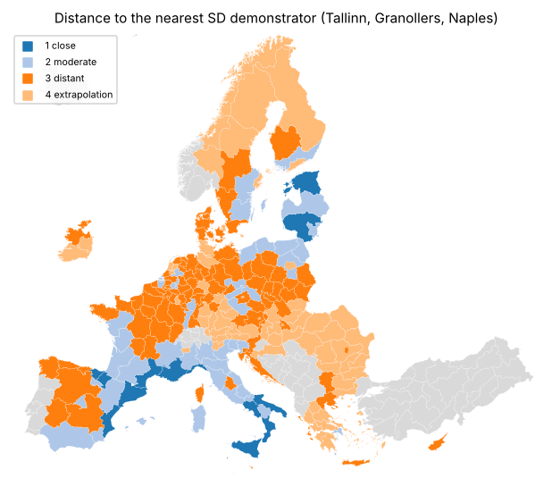

`domain_check` measures the distance of every region to the nearest demonstrator on a six-indicator lens.
13 regions are close, 48 moderate, 97 distant and 73 would be extrapolation. Vienna falls into the
extrapolation class: SD results from Tallinn, Granollers or Naples can inform a discussion about Vienna but
cannot be transferred as numbers; a calibrated Vienna model or a closer demonstrator is needed.

## Other regions

The script takes its reference regions from two lines (`resolve_id(data, "AT130")` in part 1 and the
`"EE00"` arguments in part 2). Any NUTS-3 region can replace Vienna; part 2 needs a region of the annual panel
(NUTS-0 or NUTS-2).
