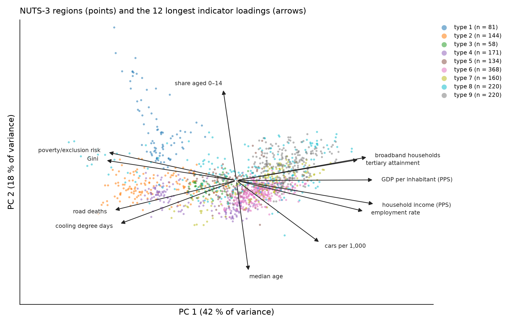
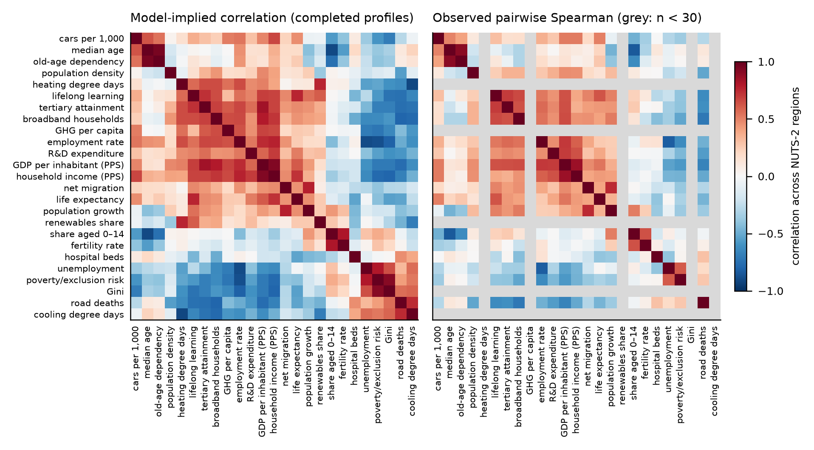
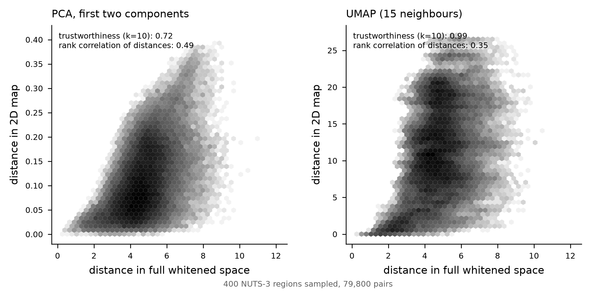
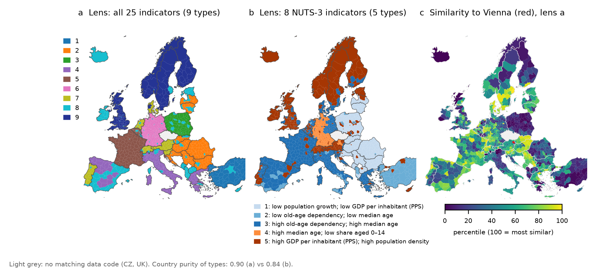
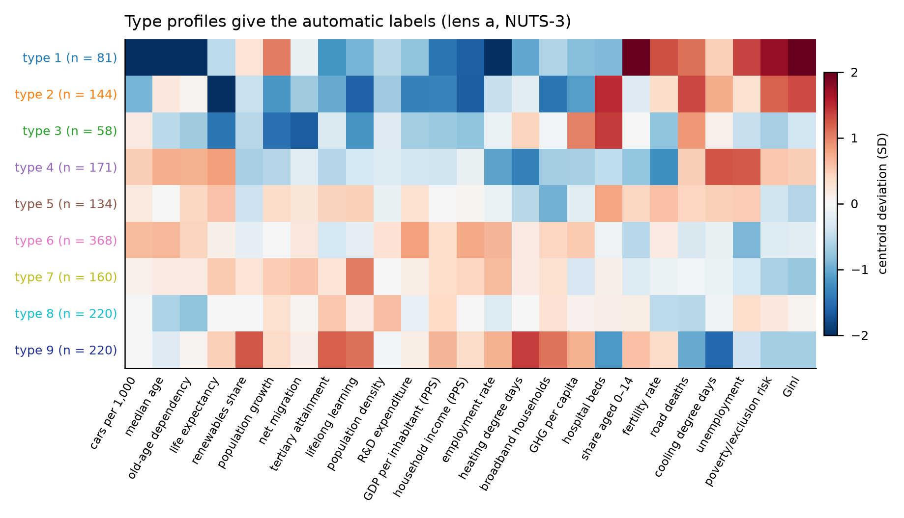
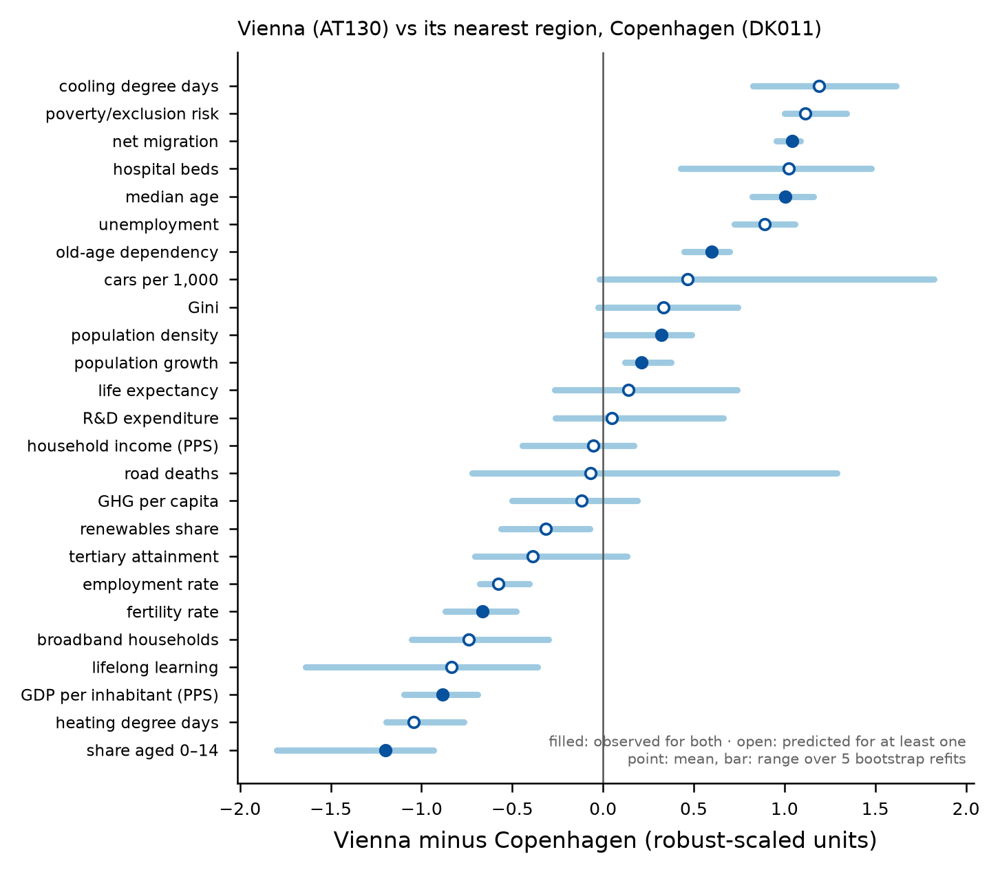
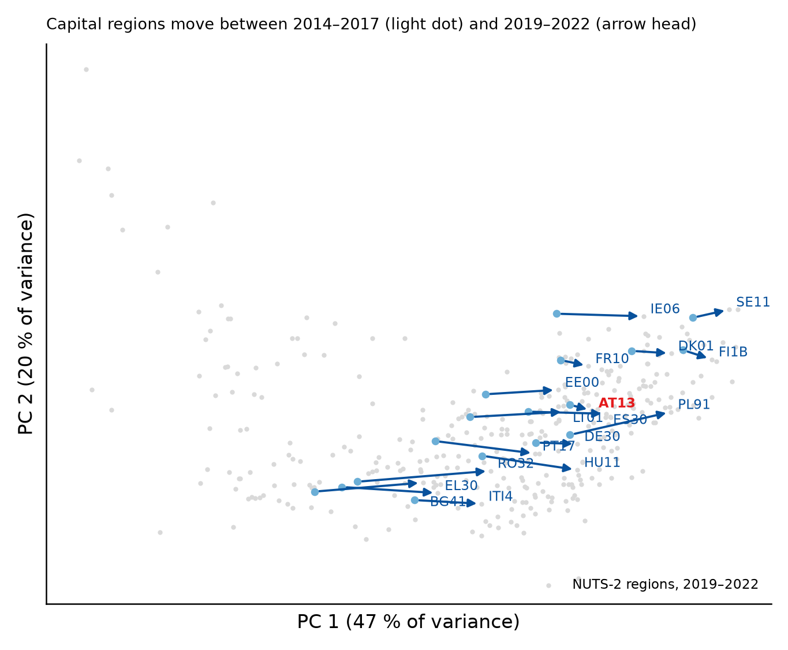
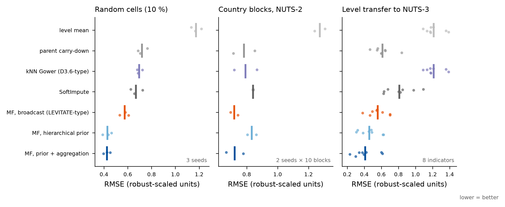
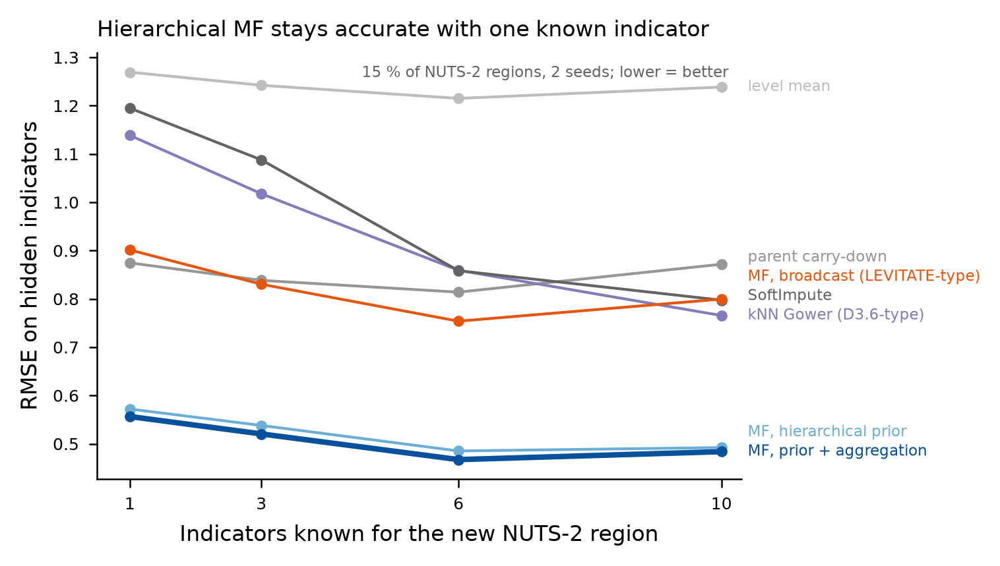

# Visualisation catalogue

`regsim report CONFIG` renders all views below from a run configuration (`runs/report-<hash>/figures`, PNG and interactive HTML; settings in the `report` section of the config); `regsim app CONFIG` is the interactive version with linked map and embedding (decision D7). The images on this page are rendered from the feasibility prototype (Eurostat, 25 indicators, NUTS-0/2/3, 2018–2022 means, hierarchical MF with aggregation constraints, rank 12). Values are illustrative of the method, not results to be quoted.

Principles that apply to all views:

1. Quantitative statements (distances, rankings, neighbours) are computed in the full space; 2D views are for orientation and always state explained variance or trustworthiness.
2. Every displayed value is marked as observed or predicted, and predicted values carry an interval.
3. The lens (indicator set, level, period) is part of the title or caption, because both similarity and typology depend on it.
4. Maps and embedding views are linked in the interactive version (selection in one highlights the other).

## V1 Joint biplot of regions and indicators

- **Shows**: NUTS-3 regions (points, coloured by type from V5) and indicator loadings (arrows) in the first two principal components of the standardised completed profiles. This is the LEVITATE joint display (D4.2 Fig. 8) in biplot form (Gabriel, 1971): arrow directions approximate correlations between indicators, point positions approximate distances between regions.
- **Prototype**: PC 1 42 %, PC 2 18 % of variance; the 12 longest loadings shown. PC 1 separates prosperity and labour-market indicators (GDP, income, employment, tertiary attainment, broadband) from poverty risk, Gini, road deaths and cooling degree days; PC 2 is mainly the age structure.
- **Rules**: label explained variance on the axes; show only loadings above a length threshold and list the rest in a table; choose the biplot scaling explicitly (row-principal for region distances, column-principal for indicator correlations).

## V2 Indicator similarity, model-implied and observed

- **Shows**: left, the model-implied correlation (I-model) across NUTS-2 regions, ordered by hierarchical clustering; right, the observed pairwise Spearman correlation in the same order, grey where fewer than 30 pairs exist.
- **Prototype**: the observed panel is empty for all national indicators (they are never observed at NUTS-2), while the model provides a full matrix. The clustered order recovers groups such as income–GDP–employment–R&D and unemployment–poverty–Gini without any thematic classification.
- **Caveat to display**: model-implied correlations involving national indicators rest on 29–35 national values; the cell should carry the effective sample size (tooltip in the interactive version).
- **Variants**: partial correlations (graphical lasso) as a network; polarity-aligned colouring (LEVITATE TargetVal) to read synergy versus conflict.

## V3 Distortion of 2D projections

- **Shows**: Shepard diagrams (distance in the full whitened space against distance in the 2D map) for 400 NUTS-3 regions, with trustworthiness (k = 10) and the rank correlation of distances.
- **Prototype**: PCA keeps global distances better (rank correlation 0.49 vs 0.35), UMAP keeps local neighbourhoods better (trustworthiness 0.99 vs 0.72). Neither is suitable for reading distances between distant regions.
- **Rule**: every 2D embedding in the tool is accompanied by these two numbers; UMAP is offered for neighbourhood exploration, PCA for directions and trajectories.

## V4 Maps of typologies and similarity under different lenses

- **Shows**: (a) typology of NUTS-3 regions on all 25 indicators (Gaussian mixture, 9 types, chosen by bootstrap stability, ARI 0.69); (b) typology on the 8 indicators observed at NUTS-3 (5 types, ARI 0.67); (c) similarity to Vienna (AT130) as percentile of the whitened profile distance.
- **Prototype finding**: with lens (a) the types follow national borders (country purity 0.90), because 17 of 25 indicators are known only at NUTS-2 or national level and the model inherits them from parents. Lens (b) reduces this (0.84) and reveals within-country contrasts such as urban cores against rural regions. The lens therefore has to be a visible, user-controlled parameter, and the share of predicted versus observed indicators per region should be mapped alongside.
- **Prototype nearest regions to Vienna (lens a)**: DK011 (Copenhagen), DE300 (Berlin), DE501 (Bremen), UKM82, SE110 (Stockholm).
- **Variants**: soft membership as transparency; boundary-only display of the applicability domain (`edge`, `outside`).

## V5 Type profiles and automatic labels

- **Shows**: standardised centroid deviation of each type on each indicator (lens a), with type colours threaded from V1 and V4. Automatic labels are the two indicators with the largest absolute deviation, e.g. type 1 "low cars per 1,000; high share aged 0–14", type 9 "low cooling degree days; high heating degree days".
- **Caveat**: centroid labels can mislead for heterogeneous types; the implementation should add within-type dispersion and the share of predicted values to each label.

## V6 Difference profile between two regions

- **Shows**: per-indicator difference between Vienna and its nearest region (Copenhagen) on the robust-scaled scale, sorted; filled markers where both values are observed, open markers where at least one is predicted; bars show the range over five bootstrap refits.
- **Purpose**: this replaces D3.6 reporting Layer 4 for any pair, including predicted values, and answers "in what respect are these two regions similar or different". The bars here only capture refit variability; the implementation shows calibrated predictive intervals.

## V7 Trajectories of geo-time entities

- **Shows**: NUTS-2 capital regions in a shared PCA space for two windows (2014–2017 and 2019–2022), fitted jointly as geo-time entities (LEVITATE approach); light dot = earlier window, arrow head = later window.
- **Prototype**: median displacement over all NUTS-2 regions 1.17 units; Vienna (AT13) 0.51, Warsaw (PL91) 2.31, Bucharest (RO32) 2.90. The common drift of all regions (e.g. rising broadband and employment) is part of the movement; the implementation offers a view relative to the European mean trajectory.
- **Rules**: joint fitting (or Procrustes alignment for separately fitted windows); a vision entity (task P4) is drawn as a target point with the "required change of direction" against the observed velocity vector (LEVITATE D4.2 p. 62).

## V8 Prediction quality and cold start

- **Shows**: hold-out RMSE by method and masking scheme, and the error for a new region as a function of the number of known indicators. These are diagnostic views for the tool's "model card", and the cold-start curve tells a user how many indicators to provide.

## Further views specified for the implementation (not rendered here)

| View | Purpose |
|---|---|
| Coverage matrix (entities × indicators, by level) | Shows sparsity and which values are observed, inherited or predicted |
| Alluvial diagram of type transitions (periods or levels) | Tracks typologies over time and across NUTS levels |
| Consensus matrix heatmap | Shows stability of a typology run |
| Observed-vs-predicted scatter with intervals per indicator | Calibration check, conformal coverage |
| Transfer-weight bar chart (task S-transfer) | Which indicators make regions similar with respect to a transferred quantity |
| Next-indicator-to-measure ranking (task P6) | Expected uncertainty reduction per candidate indicator |
| Linked map + embedding dashboard | Interactive exploration (plotly/Dash or a DSS front end via the REST service) |
